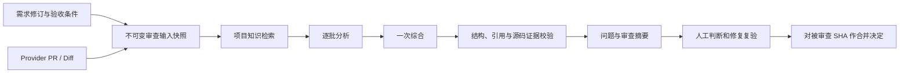

# ForgePilot 发布、设计与数据核查（2026-10-29）

当前判断：**核心 MVP 已实现并可运行，结构总体合理；具备需求和知识辅助的代码审查能力，但尚不足以称为经过充分真实业务验证的成熟产品。** 工程验证通过不等于模型判断正确，也不等于团队已经完成修复、复验和交付闭环。

## 1. 发布已完成

- 运行业务代码：`5021013e455504e65b5ee4f221e42488be3c3921`，已推送；后续仅文档/任务收尾提交不改变运行产物。
- 地址：<https://yasinlin.com>。后端、前端和 PostgreSQL 均 healthy；本机、公网健康接口均 `UP`。
- 后端/前端于 2026-10-29 16:36–16:38 UTC 更新；2026-10-30 01:21 UTC 复核仍正常。保留原数据库容器和卷；15 条 Flyway 迁移全部成功。
- 公网、本地构建和容器 JS/CSS 字节完全一致；后端 JAR 的 511 个非目录 payload 条目与本地构建一致。
- 最新数据库备份已完成并核验目录，SHA-256：`e1f609ecd44ccf1903fcd692e1925b07d33c750fbf92c959f8172c226c935410`。未做恢复演练。
- 基线更新九处前端布局、升级 Vite/Vitest 并修正知识重试接口文档；此次最小改进补候选理由/UNKNOWN、模型台账和拒绝关闭/远端终态同步，保持单引擎且未增加业务表。
- 最新业务代码干净 CI 全部成功：[40912586600](https://github.com/LinYsssss/ForgePilot/actions/runs/40912586600)。后端标准 verify 443 个测试零失败/错误/跳过；前端门禁、评测契约确定性复算和两次 fresh-volume compose smoke 通过。本地前端完整 70 个测试及受影响复查通过，lint、类型检查、构建通过。
- 基线浏览器验证 10 页 × 3 种宽度 × 2 种动效偏好，共 60 组；此次追加三页共 18 组，均无整页横向溢出或页面报错。已核对模型台账、远端状态及拒绝确认框取消，业务写请求为 0。测试身份为审查者，未覆盖所有角色的写操作。

上述测试数来自实际执行，不作为长期固定规模。基线本地后端测试曾因额外限制测试容器内存而失败；最小改进本地完整初跑也有旧 fixture/断言失败，修正后定向复查通过，随后最新 HEAD 的干净远程完整运行通过。各次原始记录保留。正式评测及 holdout 未重跑，CI 仅确定性复算。

基线证据在服务器 `/root/forgepilot-reports/release-20261029/`，此次改进证据在 `/root/forgepilot-reports/minimal-review-20261029/`；最新备份在 `/root/forgepilot-backups/minimal-review-20261029/`。仓库报告只包含非敏感聚合，不提交账号密码、仓库凭据、原始业务正文或向量。

## 2. 阅读范围与证据强度

已建立代码清单：351 个文件、54,446 行，覆盖后端主代码/资源、后端测试、前端源代码/测试、评测工具与论文复算脚本。该清单不含全部运维脚本、生成文件和历史任务材料；运维文件另行核查。

**逐文件完整通读尚未完成。** 当前内容 SHA 核验的完整通读为 224/351 文件，累计已读 19,389 行。 `reading-ledger.json` 按文件内容 SHA-256 记录已读进度；只计实际完整看到的文件，不将命令读过但输出截断的文件算作读完，也不把测试通过当作已阅读源代码。本报告是已完成发布及关键业务链核查的阶段性结论，不能声称已经逐行读完全部代码。

本轮已重点核查需求版本与状态、质量检查、实现建议、审查身份/输入快照、分批/综合/输出校验、执行租约/恢复、Finding 身份/血缘、人工决定/SCM 合并、覆盖度/校准/调用统计，以及知识、项目成员和通知的主要契约。下面区分代码确定事实、当前数据事实、设计取舍和仍需复现的疑点。

## 3. 设计是否合理

系统保持 9 个后端顶层包、21 张业务表、15 条迁移、6 个导航入口/11 条产品路由。对于当前规模，模块化单体和 PostgreSQL 足够，没有必要引入更多执行引擎或消息基础设施。

核心链路如下：

比较扎实的部分：

- **权限与数据归属**：项目作用域贯穿 SQL，复合外键及约束提供第二层保障；成员、需求、Finding 和凭据各有明确边界。
- **历史可解释**：需求离开草稿后发布新修订；审查保存输入快照，后续 PR 或需求变化不会改写历史报告。
- **失败处理有明确语义**：批次/综合格式修复仍失败时不写半份报告；截断和未审查文件有覆盖清单。
- **执行恢复**：提交后派发、租约续期、attempt/token 围栏和定时恢复配合，防止旧执行者污染新结果。
- **人工权责明确**：AI 不自动改变业务状态或代码；人工决定检查 head、输入指纹和需求修订，合并针对被审查 SHA。
- **适合当前资源规模**：低并发、短数据库事务和单一 AI 网关符合小服务器部署目标。

可接受但需要清楚说明的取舍：归档项目仍可写；多数业务列表无分页；会话存在进程内，重启后需重新登录；通知尽力发送，无可靠投递台账；合并的远端动作与本地数据库事务无法真正原子提交。这些大多已在设计中说明，不能一概称为“没实现”。

## 4. 智能能力的实际边界

当前智能能力来自三部分：模型理解需求/AC 与 diff，知识检索补充项目约束，确定性规则验证输出的结构、引用归属和源码片段是否存在。

它能给出需求质量建议、一次性实现建议、需求/代码质量问题和 AC 裁定；能提供证据、来源与跨轮次线索。**证据片段确实存在，不等于问题语义一定成立。** AC 的 COVERED/NOT_FOUND/AT_RISK/UNKNOWN 仍不是运行验证，前三者主要是模型判断，系统没有执行测试或证明验收条件成立。

当前上下文主要是 Provider patch，不包括完整仓库源码、依赖行为或调用图。实现建议也明确没有检查现有实现。跨文件缺陷、未出现在 diff 的修复措施、运行时约束及复杂业务交互容易被遗漏或误判。

本次最小改进已在 `review-6` 源码中补齐 `appendCandidates()` 的类别、解释和建议交接，并用已校验批次 AC evidence 约束 COVERED，增加 UNKNOWN。综合阶段仍没有完整 diff，候选散文仍不可信；信息交接已修正，实际准确率改善尚未测量，当前数据没有 review-6 样本。

知识检索是固定长度分块、需求/AC/路径拼接的一次查询向量、余弦距离 top-k（默认 8）。尚无相关性阈值、重排和检索质量独立评测。库中有 READY 文档，仅证明解析/向量化流程完成；不证明检索到的材料真的适用。

小 PR 也走批次加综合路径，通常有 embedding 和至少两次聊天请求。工程上保持了一条审查链，代价是时间和 token 成本。当前台账能看每次尝试的延迟/token，还不能仅凭这些数据得到整次 Review 的用户等待时间或准确金额。

## 5. 当前数据怎么样

这是 2026-10-29 只读数据库快照；发布前后聚合完全相同。历史数据主要用于演示、验收与 Halo 重放，尚不能代表稳定日常生产使用。

| 项目 | 当前数据 | 解读 |
|---|---:|---|
| 项目/账号 | 6 个项目、12 个账号 | 5 个活跃项目，1 个归档验收项目 |
| 需求 | 43 行，42 条未删除 | 39 开发中、3 草稿、1 软删除作废；DONE 为 0 |
| PR | 39 个，全部关联需求 | 4 个已配置仓库均为 GitHub；无线上 GitLab 样本 |
| 审查 | 181 次：180 完成、1 历史失败 | 历史完成率约 99.4%，并非发现准确率 |
| 当前输入适用的审查 | 39 次完成 | 35 待人工决定、3 退回、1 通过；无当前执行中或失败 |
| 问题历史 | 375 行、193 个 PR/key 身份 | 多轮重复报告，不能把 375 当作 375 个独立缺陷 |
| 当前适用审查的问题 | 76 行 | OPEN 58、CONFIRMED 11、REJECTED 6、CLOSED 1 |
| 历史修复闭环 | CLOSED 1；FIXED/VERIFIED 0 | 还缺少持续修复与复验的使用证据 |
| 知识库 | 37 文档全部 READY、132 分块 | 基础链路可用，检索准确性仍需单独测 |
| SCM 身份/项目绑定 | 0 / 0 | 开发者按本人 PR 触发/纠正关联的身份前提尚未配置 |
| 需求附件/通知配置 | 0 / 1 | 附件无线上使用样本；本轮未向外发送测试通知 |

历史审查版本分布：review-2 完成 68 次，review-3 37 次，review-4 74 次，**review-5 仅 1 次**。历史失败为 9 月 22 日的 Review 69，其 PR 后续有完成记录；不能把这条旧记录当作当前系统故障。

当前 35/39（89.7%）适用审查仍待人工决定。全历史问题状态为 OPEN 257、CONFIRMED 42、IN_PROGRESS 55、REJECTED 20、CLOSED 1，其中 SUPPRESSED 仅 2 行。大量历史 OPEN 是旧审查行，不能直接作为当前待办数；但一条已关闭问题和零 DONE 需求确实说明交付闭环证据薄弱。

AI 台账共 685 条**尝试记录**：616 成功，69 失败/超时，未成功尝试率约 10.1%。聊天审查 362 成功、32 超时、1 失败；embedding 241 成功、36 失败；实现建议 9 成功，需求质量 4 成功。重试是独立台账行，不能将 10.1% 当作审查任务失败率。

成功审查聊天请求的中位延迟 27.651 秒、P95 82.298 秒，是**单次聊天请求**；整次审查有多次请求。上报 token 合计 2,033,399；缺失用量不代表费用为零。最后模型调用为 10 月 18 日 09:39:50 UTC，本次部署没有新增模型调用，因此健康检查不能证明今日 Provider 能成功推理。模型名是请求配置名，不能证明 Provider 实际执行的底层模型身份。

## 6. 能不能证明“判断很准”

Halo 项目有 55 条首次人工判定，42 确认、13 驳回，确认比例 76.4%，95% Wilson 区间约 63.7%–85.6%。其中 HIGH 为 39/47（83.0%），MEDIUM 为 3/8（37.5%）；MEDIUM 样本少，区间很宽。没有 LOW 样本。

这些标签混合 review-2、3、4、5，review-5 只有 1 条标签且被驳回。**不能将 76.4% 写成当前 review-6 的准确率，也不能将单条驳回外推为当前版本没有效果。** 已报告问题的人工标签也无法估计漏报率：系统没报出来的缺陷不在分母里。

正式评测冻结记录保持不变。严格评分的全量召回为 12.9% / 25.8% / 32.3%；放宽到只看文件/行号后为 71.0% / 90.3% / 96.8%，后者在小 fixture 上可能把不同问题算作命中。语料还含定位/类别提示，去提示实验的位置口径召回为 67.7% / 77.4% / 83.9%。这支持“上下文可能帮助定位”，不能作为当前真实产品 96.8% 准确的依据。

评测工具没有调用后端，且去提示实验复用已揭晓语料、分析为事后设计；两者都不能证明当前检索链和 prompt 已经成熟。详见 [效度与敏感性分析](../../../docs/thesis/EVALUATION-SENSITIVITY.md)。

## 7. 优先处理什么

| 优先级 | 问题与证据 | 建议 |
|---|---|---|
| P1 | review-6 尚无真实推理/标签样本；review-5 只有 1 次完成和 1 条标签 | 用新案例及独立真值验证当前版本；分开记录引擎版本、PR、首次标签与漏报。不要调参或重跑冻结 holdout |
| 已修源码/待效果验证 | 批次候选理由交接原先丢失；现已补类别/解释/建议及 UNKNOWN 证据门槛 | 运行独立新样例前，不能声称准确率提高；综合仍以有限证据判断 |
| P1 | 需求质量结果存在旧文本覆盖竞态：`RequirementQualityService.store` 只按 revision id 写回 | AI 调用前记录内容代次/指纹，写回时条件比较；冲突返回可操作提示。无需跨外部调用持有事务 |
| P2 | 需求页面发布新修订后的 `run()` 只更新详情/修订列表，没有重新读取 `coverage` 和 `reviewActivity`；路由 id 没变时不会触发 `load()` | 更新修订后刷新派生面板，确保不会在新修订旁继续展示旧裁定；用模拟 API 测试这个页面内更新，无需改线上业务数据 |
| P1 | 本人 PR 权限依赖 SCM 身份，但线上身份/绑定为零 | 接通实际开发者身份与项目绑定，验收开发者、审查者、负责人完整协作链；不能替用户猜账号绑定 |
| P1 | 数据几乎没有修复复验与需求完成闭环 | 在新业务样例上完成确认、指派、修复、复验、关闭、最终决定及需求验收，记录耗时与真实反馈 |
| P2 | Finding key 包含行号与模型原始 category；同一缺陷移动行号/类别变化会变成 NEW | 增加稳定性测量和显式人工关联；如改确定性规则，先设计版本/历史迁移，不能随意递增 RULE_VERSION |
| P2 | PERSISTING 每轮重新从 OPEN 起步，不继承已确认/处理中的状态或处理人 | 明确每轮观察与长期修复工作分别代表什么，减少重复认领/确认；任何继承规则调整均须保留人工判断边界及审计 |
| P2 | 覆盖度只取当前需求修订的最近一次完成审查，没有 PR head/fingerprint 新鲜度检查 | 显示来源审查和是否过期；多 PR 需求明确局部结果含义。当前快照未发现过期样本或多 PR 需求 |
| P2 | “未决”只数 OPEN，与“未修复”是不同口径；当前另外 11 条 CONFIRMED 不在此计数中 | 保留待判定数，另显示待修复数；通知文案“待处理”应明确口径。这是语义容易误读，不应直接称统计 SQL 错误 |
| P2 | 固定 top-k 无适用性阈值/重排，READY 不证明召回有效 | 用独立问题-知识匹配集测召回与噪声，允许明确“无相关知识”，先测再调 |
| P2 | 合并同步持有 PR 锁及数据库连接，远端合并/本地提交有非原子窗口 | 保留 SHA 检查，补充明确的人工核对/状态修复操作规范；高并发前测连接池影响 |
| P3 | 内存会话、列表规模、通知尽力发送、基础镜像标签可漂移 | 随真实使用规模推进分页、运行监控、备份恢复演练与镜像可复现性 |

另外一个**尚需隔离测试复现**的代码疑点：仓库尚无 PR 时允许身份修改，Webhook 在 Provider 拉取期间可能持有旧仓库上下文；`PullRequestSyncService.apply` 加锁重读当前仓库，却没有显式比较它与拉取时身份是否相同。需要验证首个 PR 是否可能把旧快照归到新身份。现有线上四个仓库均已有 PR，身份冻结已生效；本轮没有观察到线上数据异常，不把这个疑点写成已复现故障。

原阶段对“需求详情切换记录后旧动作污染新页面”的判断已撤回：`AppShell.vue` 按 `route.fullPath` 重挂组件，生产路由切换具备实例隔离。直接挂载单页组件的测试不能证明生产路由污染。同页面发布修订后派生面板未刷新仍是独立可确认问题。

## 8. 功能完善程度

账号/项目/成员、需求与修订/指派、质量与实现建议、知识处理/重试、仓库/Webhook/关联纠正、审查执行/详情/证据/问题状态、人工决定与合并、校准/用量、通知配置等核心功能均有实现。当前构建和已运行验证支持继续用于演示与小范围试用。

“已经完善”目前还不成立。下一轮价值最大的工作是把当前引擎真实效果和协作修复闭环测清楚，修掉已经确认的质量写回竞态，并让知识召回、覆盖度及问题连续性更容易解释。继续增加页面或引入更多智能执行层并不能替代这些验证。

完整逐文件阅读仍在进行；具体剩余范围与新增结论须按阅读台账继续更新。本任务保持进行中，不将阶段报告或发布成功当作全部验收完成。

主要源码定位：[质量检查写回](../../../backend/src/main/java/com/forgepilot/requirement/RequirementQualityService.java)、[需求详情与派生视图刷新](../../../frontend/src/features/requirement/RequirementDetailPage.vue)、[覆盖度读取](../../../backend/src/main/java/com/forgepilot/review/ReviewInsightRepository.java)、[问题身份规则](../../../backend/src/main/java/com/forgepilot/review/FindingKeys.java)、[审查执行流水线](../../../backend/src/main/java/com/forgepilot/review/ReviewPipeline.java)、[Webhook 快照入库](../../../backend/src/main/java/com/forgepilot/scm/PullRequestSyncService.java)。
