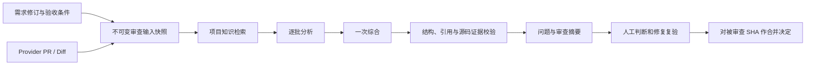

# ForgePilot 发布、全量业务代码与数据审计（2026-10-29 / 10-30，已完成）

当前判断：**核心 MVP 已实现并可运行，结构总体合理；具备需求和知识辅助的代码审查能力，但尚不足以称为经过充分真实业务验证的成熟产品。** 工程验证通过不等于模型判断正确，也不等于团队已经完成修复、复验和交付闭环。

## 1. 发布已完成

- 运行业务代码：`5021013e455504e65b5ee4f221e42488be3c3921`，已推送；后续仅文档/任务收尾提交不改变运行产物。
- 2026-10-30 再次 fetch 确认本地与远程 main 均为 `76ed32e`；与业务提交的 backend/frontend/compose 差异为空。再次验证公网健康 `UP`、三容器 healthy、前端公网/容器/本地产物摘要相同、后端部署 JAR 与前次取样相同、业务数据聚合不变。
- 地址：<https://yasinlin.com>。后端、前端和 PostgreSQL 均 healthy；本机、公网健康接口均 `UP`。
- 后端/前端于 2026-10-29 16:36–16:38 UTC 更新；2026-10-30 01:21 UTC 复核仍正常。保留原数据库容器和卷；15 条 Flyway 迁移全部成功。
- 公网、本地构建和容器 JS/CSS 字节完全一致；后端 JAR 的 511 个非目录 payload 条目与本地构建一致。
- 最新数据库备份已完成并核验目录，SHA-256：`e1f609ecd44ccf1903fcd692e1925b07d33c750fbf92c959f8172c226c935410`。未做恢复演练。
- 基线更新九处前端布局、升级 Vite/Vitest 并修正知识重试接口文档；此次最小改进补候选理由/UNKNOWN、模型台账和拒绝关闭/远端终态同步，保持单引擎且未增加业务表。
- 最新业务代码干净 CI 全部成功：[40912586600](https://github.com/LinYsssss/ForgePilot/actions/runs/40912586600)。后端标准 verify 443 个测试零失败/错误/跳过；前端门禁、评测契约确定性复算和两次 fresh-volume compose smoke 通过。本地前端完整 70 个测试及受影响复查通过，lint、类型检查、构建通过。
- 基线浏览器验证 10 页 × 3 种宽度 × 2 种动效偏好，共 60 组；此次追加三页共 18 组，均无整页横向溢出或页面报错。已核对模型台账、远端状态及拒绝确认框取消，业务写请求为 0。测试身份为审查者，未覆盖所有角色的写操作。

上述测试数来自实际执行，不作为长期固定规模。基线本地后端测试曾因额外限制测试容器内存而失败；最小改进本地完整初跑也有旧 fixture/断言失败，修正后定向复查通过，随后最新 HEAD 的干净远程完整运行通过。各次原始记录保留。正式评测及 holdout 未重跑，CI 仅确定性复算。

基线证据在服务器 `/root/forgepilot-reports/release-20261029/`，此次改进证据在 `/root/forgepilot-reports/minimal-review-20261029/`；最新备份在 `/root/forgepilot-backups/minimal-review-20261029/`。仓库报告只包含非敏感聚合，不提交账号密码、仓库凭据、原始业务正文或向量。

## 2. 阅读范围与证据强度

已建立代码清单：351 个文件、54,446 行，覆盖后端主代码/资源、后端测试、前端源代码/测试、评测工具与论文复算脚本。该清单不含全部运维脚本、生成文件和历史任务材料；运维文件另行核查。

**清单内逐文件完整通读已完成：351/351 文件、54,446/54,446 行。** 2026-10-30 01:55 UTC 逐一核验当前文件内容 SHA-256、清单行数与阅读台账完全一致，并用 `rg --files` 复核所列目录及源码后缀的文件集合，无遗漏。`reading-ledger.json` 只计实际完整看到的范围，不将输出截断或测试通过当作已阅读源代码。可移植的汇总证据见 [reading-progress.json](./reading-progress.json)；逐文件摘要在服务器 `reading-verification-20261030.json`。

范围为后端主代码/资源 215 文件、后端测试与测试 fixture 63 文件、前端源码 39 文件、前端测试 18 文件、评测工具 10 文件、论文脚本 6 文件。运维与演示仓库、生成文件及历史任务材料不属于这份业务代码清单；运维发布配置已另行检查，不能据此声称仓库所有历史材料均已通读。

本轮已重点核查需求版本与状态、质量检查、实现建议、审查身份/输入快照、分批/综合/输出校验、执行租约/恢复、Finding 身份/血缘、人工决定/SCM 合并、覆盖度/校准/调用统计，以及知识、项目成员和通知的主要契约。下面区分代码确定事实、当前数据事实、设计取舍和仍需复现的疑点。

## 3. 设计是否合理

系统保持 9 个后端顶层包、21 张业务表、15 条迁移、6 个导航入口/11 条产品路由。对于当前规模，模块化单体和 PostgreSQL 足够，没有必要引入更多执行引擎或消息基础设施。

核心链路如下：

比较扎实的部分：

- **权限与数据归属**：项目作用域贯穿 SQL，复合外键及约束提供第二层保障；成员、需求、Finding 和凭据各有明确边界。
- **历史可解释**：需求离开草稿后发布新修订；审查保存输入快照，后续 PR 或需求变化不会改写历史报告。
- **失败处理有明确语义**：批次/综合格式修复仍失败时不写半份报告；截断和未审查文件有覆盖清单。
- **执行恢复**：提交后派发、租约续期、attempt/token 围栏和定时恢复配合，防止旧执行者污染新结果。
- **人工权责明确**：AI 不自动改变业务状态或代码；人工决定检查 head、输入指纹和需求修订，合并针对被审查 SHA。
- **适合当前资源规模**：低并发、短数据库事务和单一 AI 网关符合小服务器部署目标。

可接受但需要清楚说明的取舍：归档项目仍可写；多数业务列表无分页；会话存在进程内，重启后需重新登录；通知尽力发送，无可靠投递台账；合并的远端动作与本地数据库事务无法真正原子提交。这些大多已在设计中说明，不能一概称为“没实现”。

## 4. 智能能力的实际边界

当前智能能力来自三部分：模型理解需求/AC 与 diff，知识检索补充项目约束，确定性规则验证输出的结构、引用归属和源码片段是否存在。

它能给出需求质量建议、一次性实现建议、需求/代码质量问题和 AC 裁定；能提供证据、来源与跨轮次线索。**证据片段确实存在，不等于问题语义一定成立。** AC 的 COVERED/NOT_FOUND/AT_RISK/UNKNOWN 仍不是运行验证，前三者主要是模型判断，系统没有执行测试或证明验收条件成立。

当前上下文主要是 Provider patch，不包括完整仓库源码、依赖行为或调用图。实现建议也明确没有检查现有实现。跨文件缺陷、未出现在 diff 的修复措施、运行时约束及复杂业务交互容易被遗漏或误判。

本次最小改进已在 `review-6` 源码中补齐 `appendCandidates()` 的类别、解释和建议交接，并用已校验批次 AC evidence 约束 COVERED，增加 UNKNOWN。综合阶段仍没有完整 diff，候选散文仍不可信；信息交接已修正，实际准确率改善尚未测量，当前数据没有 review-6 样本。

知识检索是固定长度分块、需求/AC/路径拼接的一次查询向量、余弦距离 top-k（默认 8）。尚无相关性阈值、重排和检索质量独立评测。库中有 READY 文档，仅证明解析/向量化流程完成；不证明检索到的材料真的适用。

小 PR 也走批次加综合路径，通常有 embedding 和至少两次聊天请求。工程上保持了一条审查链，代价是时间和 token 成本。当前台账能看每次尝试的延迟/token，还不能仅凭这些数据得到整次 Review 的用户等待时间或准确金额。

## 5. 当前数据怎么样

这是 2026-10-29 只读数据库快照，2026-10-30 已用原 SQL 再核；发布前后及隔离复现后聚合完全相同。历史数据主要用于演示、验收与 Halo 重放，尚不能代表稳定日常生产使用。

| 项目 | 当前数据 | 解读 |
|---|---:|---|
| 项目/账号 | 6 个项目、12 个账号 | 5 个活跃项目，1 个归档验收项目 |
| 需求 | 43 行，42 条未删除 | 39 开发中、3 草稿、1 软删除作废；DONE 为 0 |
| PR | 39 个，全部关联需求 | 4 个已配置仓库均为 GitHub；无线上 GitLab 样本 |
| 审查 | 181 次：180 完成、1 历史失败 | 历史完成率约 99.4%，并非发现准确率 |
| 当前输入适用的审查 | 39 次完成 | 35 待人工决定、3 退回、1 通过；无当前执行中或失败 |
| 问题历史 | 375 行、193 个 PR/key 身份 | 多轮重复报告，不能把 375 当作 375 个独立缺陷 |
| 当前适用审查的问题 | 76 行 | OPEN 58、CONFIRMED 11、REJECTED 6、CLOSED 1 |
| 历史修复闭环 | CLOSED 1；FIXED/VERIFIED 0 | 还缺少持续修复与复验的使用证据 |
| 知识库 | 37 文档全部 READY、132 分块 | 基础链路可用，检索准确性仍需单独测 |
| SCM 身份/项目绑定 | 0 / 0 | 开发者按本人 PR 触发/纠正关联的身份前提尚未配置 |
| 需求附件/通知配置 | 0 / 1 | 附件无线上使用样本；本轮未向外发送测试通知 |

历史审查版本分布：review-2 完成 68 次，review-3 37 次，review-4 74 次，**review-5 仅 1 次**。历史失败为 9 月 22 日的 Review 69，其 PR 后续有完成记录；不能把这条旧记录当作当前系统故障。

当前 35/39（89.7%）适用审查仍待人工决定。全历史问题状态为 OPEN 257、CONFIRMED 42、IN_PROGRESS 55、REJECTED 20、CLOSED 1，其中 SUPPRESSED 仅 2 行。大量历史 OPEN 是旧审查行，不能直接作为当前待办数；但一条已关闭问题和零 DONE 需求确实说明交付闭环证据薄弱。

AI 台账共 685 条**尝试记录**：616 成功，69 失败/超时，未成功尝试率约 10.1%。聊天审查 362 成功、32 超时、1 失败；embedding 241 成功、36 失败；实现建议 9 成功，需求质量 4 成功。重试是独立台账行，不能将 10.1% 当作审查任务失败率。

成功审查聊天请求的中位延迟 27.651 秒、P95 82.298 秒，是**单次聊天请求**；整次审查有多次请求。上报 token 合计 2,033,399；缺失用量不代表费用为零。最后模型调用为 10 月 18 日 09:39:50 UTC，本次部署没有新增模型调用，因此健康检查不能证明今日 Provider 能成功推理。模型名是请求配置名，不能证明 Provider 实际执行的底层模型身份。

## 6. 能不能证明“判断很准”

Halo 项目按每条 Finding 首次人工判定计有 55 条，42 确认、13 驳回，确认比例 76.4%。其中 HIGH 为 39/47（83.0%），MEDIUM 为 3/8（37.5%）；没有 LOW 样本。2026-10-30 只读复核发现其中 11 条重复同一 PR/key 身份；按每个 PR/key 的首次标签计为 32/44（72.7%），HIGH 为 29/36，MEDIUM 为 3/8。去重仍不保证标签独立或 key 等于语义缺陷身份；同 PR 相关性存在，不能把二项独立抽样的 Wilson 区间当作严格的生产准确率置信保证。详细 SQL 与复核见 [隔离复现和统计口径](./REPRODUCTIONS-20261030.md)。

这些标签混合 review-2、3、4、5，review-5 只有 1 条标签且被驳回。**不能将 76.4% 写成当前 review-6 的准确率，也不能将单条驳回外推为当前版本没有效果。** 已报告问题的人工标签也无法估计漏报率：系统没报出来的缺陷不在分母里。

正式评测冻结记录保持不变。严格评分的全量召回为 12.9% / 25.8% / 32.3%；放宽到只看文件/行号后为 71.0% / 90.3% / 96.8%，后者在小 fixture 上可能把不同问题算作命中。语料还含定位/类别提示，去提示实验的位置口径召回为 67.7% / 77.4% / 83.9%。这支持“上下文可能帮助定位”，不能作为当前真实产品 96.8% 准确的依据。

评测工具没有调用后端，且去提示实验复用已揭晓语料、分析为事后设计；两者都不能证明当前检索链和 prompt 已经成熟。详见 [效度与敏感性分析](../../../docs/thesis/EVALUATION-SENSITIVITY.md)。

## 7. 优先处理什么

| 优先级 | 问题与证据 | 建议 |
|---|---|---|
| P1 | review-6 尚无真实推理/标签样本；review-5 只有 1 次完成和 1 条标签 | 用新案例及独立真值验证当前版本；分开记录引擎版本、PR、首次标签与漏报。不要调参或重跑冻结 holdout |
| 已修源码/待效果验证 | 批次候选理由交接原先丢失；现已补类别/解释/建议及 UNKNOWN 证据门槛 | 运行独立新样例前，不能声称准确率提高；综合仍以有限证据判断 |
| P1 / 已修复（2026-11-08，任务 11-08-audit-race-fixes） | 隔离 PostgreSQL 证明编辑提交后旧质量评估重新写回；真实 App 的模拟 API 也证明草稿保存后晚到的旧质量报告会重新显示 | 后端写回比较正文与 AC 的内容指纹；前端质量请求增加代次，并在保存/发布和卸载时撤销旧响应。两层均须修复 |
| P2 / 已复现 | 真实 App 发布新修订后 `run()` 只更新详情/修订列表，`coverage` 和 `reviewActivity` 未重新请求，继续显示旧裁定；路由 id 没变时不会触发 `load()` | 更新修订后刷新派生面板，刷新失败时使旧值明确失效；用模拟 API 验证页面内更新，无需改线上业务数据 |
| P1 / 已修复（2026-11-08，任务 11-08-audit-race-fixes） | 首次 PR 拉取期间提交仓库身份变更后，旧仓库快照仍会被 `apply` 接收到新身份下，指纹也按新身份计算 | 行锁内比较拉取时与当前稳定身份；不同则拒绝旧快照，锁外重拉。现有线上仓库均已有 PR，未观察到线上错归属 |
| P1 | 本人 PR 权限依赖 SCM 身份，但线上身份/绑定为零 | 接通实际开发者身份与项目绑定，验收开发者、审查者、负责人完整协作链；不能替用户猜账号绑定 |
| P1 | 数据几乎没有修复复验与需求完成闭环 | 在新业务样例上完成确认、指派、修复、复验、关闭、最终决定及需求验收，记录耗时与真实反馈 |
| P2 | Finding key 包含行号与模型原始 category；同一缺陷移动行号/类别变化会变成 NEW | 增加稳定性测量和显式人工关联；如改确定性规则，先设计版本/历史迁移，不能随意递增 RULE_VERSION |
| P2 | PERSISTING 每轮重新从 OPEN 起步，不继承已确认/处理中的状态或处理人 | 明确每轮观察与长期修复工作分别代表什么，减少重复认领/确认；任何继承规则调整均须保留人工判断边界及审计 |
| P2 | 覆盖度只取当前需求修订的最近一次完成审查，没有 PR head/fingerprint 新鲜度检查 | 显示来源审查和是否过期；多 PR 需求明确局部结果含义。当前快照未发现过期样本或多 PR 需求 |
| P2 | “未决”只数 OPEN，与“未修复”是不同口径；当前另外 11 条 CONFIRMED 不在此计数中 | 保留待判定数，另显示待修复数；通知文案“待处理”应明确口径。这是语义容易误读，不应直接称统计 SQL 错误 |
| P2 | 固定 top-k 无适用性阈值/重排，READY 不证明召回有效 | 用独立问题-知识匹配集测召回与噪声，允许明确“无相关知识”，先测再调 |
| P2 | 合并同步持有 PR 锁及数据库连接，远端合并/本地提交有非原子窗口 | 保留 SHA 检查，补充明确的人工核对/状态修复操作规范；高并发前测连接池影响 |
| P2 | 负责人通知配置缺少窄屏布局：390px 下仍是两列，表单列约 60px；只读浏览器和截图已确认 | 对通知编辑区复用仓库编辑区的一列断点；补角色覆盖的视觉核验。整页无横向溢出不证明控件可用 |
| P3 | 成员搜索脚本允许单字符数字 ID，但输入框 minlength=2；浏览器输入 1 后 tooShort=true | 让表单校验与数字 ID 的查询规则一致 |
| P3 | 成员页 SCM 绑定审批的 decide() 直接 await，没有 catch 或局部错误状态 | 沿用该页 error/pending，在审批失败时给可操作反馈；此项为源码事实，未执行线上审批故障注入 |
| P3 | 内存会话、列表规模、通知尽力发送、基础镜像标签可漂移 | 随真实使用规模推进分页、运行监控、备份恢复演练与镜像可复现性 |

上述首次 PR 身份疑点已在隔离测试中复现。加锁重读修复了入库期间身份再变化的窗口，但不能证明外部拉取的来源与当前仓库相同；旧 patch 按新身份计算的指纹仍可重算，因此“指纹可复现”不能代替来源校验。四项观察测试通过意味着缺陷出现，**不意味着缺陷已修复**。详情见 [复现报告](./REPRODUCTIONS-20261030.md)。

原阶段对“需求详情切换记录后旧动作污染新页面”的判断已撤回：`AppShell.vue` 按 `route.fullPath` 重挂组件，生产路由切换具备实例隔离。直接挂载单页组件的测试不能证明生产路由污染。同页面发布修订后派生面板未刷新仍是独立可确认问题。

## 8. 功能完善程度

账号/项目/成员、需求与修订/指派、质量与实现建议、知识处理/重试、仓库/Webhook/关联纠正、审查执行/详情/证据/问题状态、人工决定与合并、校准/用量、通知配置等核心功能均有实现。当前构建和已运行验证支持继续用于演示与小范围试用。

“已经完善”目前还不成立。下一轮价值最大的工作是把当前引擎真实效果和协作修复闭环测清楚，修掉已经确认的质量写回竞态，并让知识召回、覆盖度及问题连续性更容易解释。继续增加页面或引入更多智能执行层并不能替代这些验证。

补充只读浏览器使用已核验角色的演示负责人 dev01（项目 6）检查通知布局与成员搜索；不使用账号原始凭据作为报告内容，不发业务写请求。截图/结果位于服务器 `/root/forgepilot-reports/release-20261029/leader-readonly-check.json` 及同目录 `leader-repository-*.png`。

审计与清单阅读已经完成；上述缺陷修复和当前引擎独立效果实验仍未实施，不能将“审计完成”理解为“问题全部修好”。本次续读只更新审计材料，未修改业务源码或再次部署。01:55 UTC 再次 fetch 确认本地/远程仍为 `76ed32e`，业务提交至 HEAD 无 backend/frontend/compose 差异，三个容器 healthy、公网健康 `UP`。

## 9. 测试保障与后续顺序

最后一批后端测试完整阅读确认：审查决定有真实数据库并发和锁等待观察；人工重审与 Webhook 保持各自输入快照；租约丢失后的完成、失败、续租、Finding 写入均有防护测试；批次失败不会留下半份报告，未审查文件有明确清单；GitHub/GitLab 覆盖签名、权威读取、分页、远端响应丢失与读回确认。审查集成测试使用真实内部组件和 PostgreSQL，但用脚本化响应替代模型，因此证明调用链接通与规则执行，不能证明真实推理准确性。

测试缺口也已经定位：质量检查旧结果的现有测试只覆盖“检查完成后编辑”；后端覆盖度测试验证重新读取后的结果，却没有覆盖页面发布后是否重新请求；仓库身份冻结测试保护入库期间的变更，却未比较拉取时身份。这与四项隔离复现一致，本轮未从剩余测试中确认新的独立缺陷。没有重复运行已通过的全套验证，也没有触碰冻结 holdout。

建议按以下可独立验收的顺序推进：

1. 修复质量结果后端写回和前端响应代次，以及首个 PR 的来源身份比较；把观察测试改成正确行为的回归断言，补正常请求与仅 AC 变化的对照。
2. 修复新修订派生面板刷新、手机通知表单和数字成员 ID 校验，覆盖真实 App、对应角色与窄屏操作。
3. 由真实开发者建立 SCM 身份及项目绑定，用新业务样例完成修复、复验、合并及需求 DONE；此前数据不代替这一步验收。
4. 为 review-6 建立独立新样例和人工真值，分别测缺陷命中、误报、漏报、知识适用性、端到端等待时间和调用量；保留原冻结实验。

复杂业务修复进入独立设计与实施任务；本报告已给出触发条件、影响范围与修复边界。当前审计文档保留在本地，尚未新增提交或推送。

主要源码定位：[质量检查写回](../../../backend/src/main/java/com/forgepilot/requirement/RequirementQualityService.java)、[需求详情与派生视图刷新](../../../frontend/src/features/requirement/RequirementDetailPage.vue)、[覆盖度读取](../../../backend/src/main/java/com/forgepilot/review/ReviewInsightRepository.java)、[问题身份规则](../../../backend/src/main/java/com/forgepilot/review/FindingKeys.java)、[审查执行流水线](../../../backend/src/main/java/com/forgepilot/review/ReviewPipeline.java)、[Webhook 快照入库](../../../backend/src/main/java/com/forgepilot/scm/PullRequestSyncService.java)。

## 10. 后续修复状态（2026-11-08）

§7 中质量结果后端写回、前端晚到旧报告、首次 PR 旧仓库快照三项已在任务 `11-08-audit-race-fixes` 修复：写回在需求行锁内比较正文与 AC，不一致返回 409；前端质量请求增加请求序号；`apply` 比较拉取所用稳定身份，不一致返回 401。三条观察测试已改为正确行为的回归断言，并确认在撤回修复后失败。新修订后派生面板不刷新（P2）及其余 P2/P3 仍未处理。部署状态见该任务记录。

同日任务 `11-08-audit-ui-followups` 修复 §9 第 2 步的四项前端问题：发布后派生面板刷新、通知编辑区窄屏单列、成员数字 ID 校验、SCM 绑定审批错误提示。均已部署（前端 `index-CJiir1mx.js`）。仍待处理：第 3 步真实 SCM 身份绑定与协作闭环、第 4 步 review-6 独立样例，以及 §7 中涉及设计取舍的 P2（Finding key 稳定性、PERSISTING 状态继承、覆盖度新鲜度、口径与检索阈值）。
